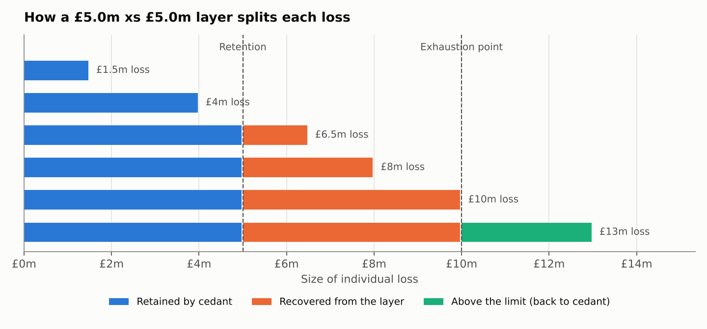
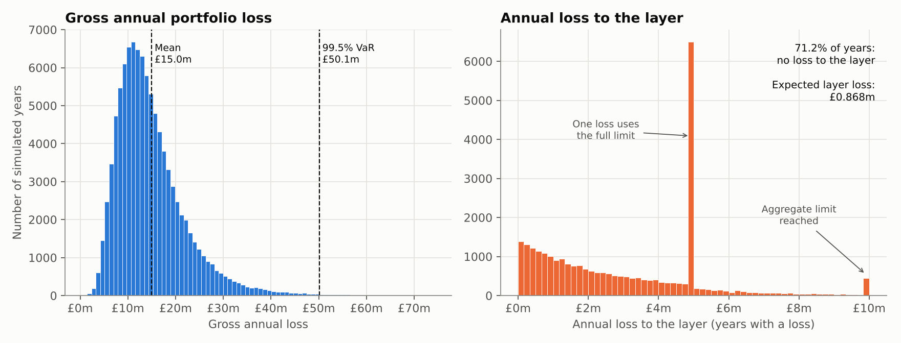
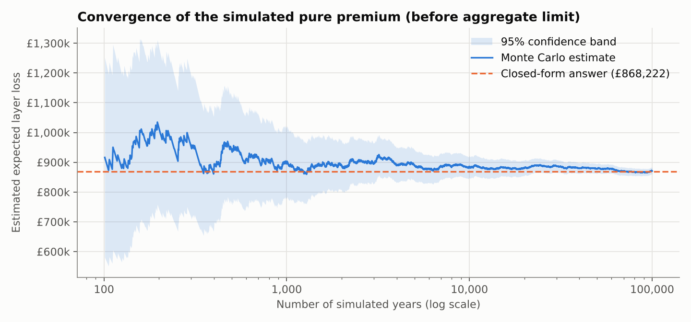
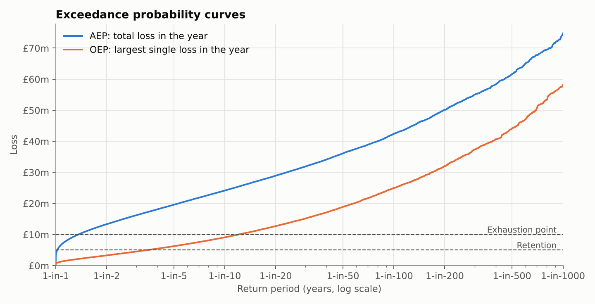
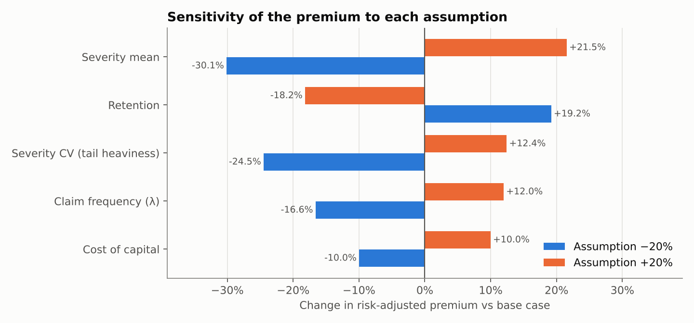

# Stochastic Reinsurance Pricing Model


A Monte Carlo model that prices a per-risk **Excess of Loss (XoL) reinsurance treaty**. It simulates 100,000 years of large losses with a compound **Poisson–Lognormal** model, passes each loss through the layer, and builds a premium from the expected layer loss plus a **cost-of-capital risk load**, expenses, brokerage and reinstatement terms.

The simulated pure premium is checked against an exact closed-form answer, and the two agree to within 0.4%.

---

## Contents

1. [The problem](#1-the-problem)
2. [Headline results](#2-headline-results)
3. [Method](#3-method)
4. [Validation](#4-validation)
5. [Charts](#5-charts)
6. [Layering and sensitivity](#6-layering-and-sensitivity)
7. [How to run it](#7-how-to-run-it)
8. [Project structure](#8-project-structure)
9. [Assumptions and limitations](#9-assumptions-and-limitations)
10. [Possible extensions](#10-possible-extensions)

Full derivations are in [`docs/methodology.md`](docs/methodology.md).

---

## 1. The problem

An insurer writes a portfolio that produces around **25 large losses a year**, averaging **£600k** each but with a heavy right tail. To protect itself against individual large losses, it buys a **£5m xs £5m** per-risk Excess of Loss treaty:

- for every loss, the insurer (the *cedant*) keeps the first £5m (the **retention**);
- the reinsurer pays the part of the loss between £5m and £10m, up to £5m per loss (the **limit**);
- anything above £10m (the **exhaustion point**) goes back to the cedant;
- the limit can be used twice a year: the cover comes with **one reinstatement at 100%**.

The question is what premium the reinsurer should charge for this layer.



Losses to a layer are rare and very volatile, so the expected loss can't be read off a few years of history. The model builds the full distribution of possible annual outcomes by simulation and prices from that distribution.

---

## 2. Headline results

Base case: 100,000 simulated years, seed 2026 (full output in [`results/pricing_summary.md`](results/pricing_summary.md)).

| | Value |
|---|---:|
| Expected gross annual loss to the portfolio | £14.97m |
| Probability the layer is hit in a year | 28.8% (about 1-in-3.5 years) |
| Probability a single loss exhausts the layer | 8.3% (about 1-in-12 years) |
| **Expected annual layer loss (pure premium)** | **£868,479** ± £11,300 (95% CI) |
| 99.5% VaR of annual layer loss | £9.49m |
| Capital held (99.5% VaR − mean) | £8.62m |
| Cost-of-capital risk load (10%) | £862,022 |
| **Risk-adjusted premium** | **£1,730,501** |
| Gross technical premium (after 5% expenses, 10% brokerage) | £2,035,883 |
| **Upfront premium** (allowing for expected reinstatement premium) | **£1,752,394** |
| Rate on line | 35.0% |
| Expected loss ratio | 42.7% |

---

## 3. Method

### 3.1 Loss model (collective risk model)

Each simulated year $`j`$ has a random number of large losses, each of random size:

```math
N_j \sim \text{Poisson}(\lambda), \qquad X_{ij} \sim \text{Lognormal}(\mu, \sigma^2), \qquad S_j = \sum_{i=1}^{N_j} X_{ij}
```

- **Poisson frequency** assumes losses arrive independently at a constant average rate, so the variance of the count equals its mean.
- **Lognormal severity** is right-skewed and heavy-tailed, which suits large commercial losses.

The inputs are stated as a mean and a coefficient of variation (CV), because those are easier to reason about than $`\mu`$ and $`\sigma`$. The model converts them:

```math
\sigma^2 = \ln(1 + \text{CV}^2), \qquad \mu = \ln(\text{mean}) - \tfrac{1}{2}\sigma^2
```

| Assumption | Base case |
|---|---:|
| Claim frequency $`\lambda`$ | 25 per year |
| Mean loss | £600,000 |
| CV of loss size | 2.5 |
| Implied $`\mu`$, $`\sigma`$ | 12.31, 1.41 |

### 3.2 Applying the layer

For a layer of limit $`L`$ excess of retention $`R`$, the reinsurer's recovery from one loss is

```math
Y_{ij} = \min\big(\max(X_{ij} - R,\ 0),\ L\big)
```

and the annual loss to the layer, after the annual aggregate limit $`\text{AAL} = (k+1)L`$ for $`k`$ reinstatements, is

```math
Z_j = \min\Big(\sum_{i=1}^{N_j} Y_{ij},\ \text{AAL}\Big)
```

### 3.3 Simulation

The engine is fully vectorised in NumPy. All losses for all 100,000 years (about 2.5 million) are drawn in a single call, mapped back to their year with `np.repeat`, and summed per year with `np.bincount`. A full run takes about 0.1 seconds. A fixed seed makes every run reproducible.

### 3.4 From expected loss to premium

| Step | Formula | Reasoning |
|---|---|---|
| Pure premium | $`\text{EL} = \mathbb{E}[Z]`$ | Average annual cost of claims to the layer |
| Capital | $`C = \text{VaR}_{99.5\%}(Z) - \mathbb{E}[Z]`$ | Money held to survive a 1-in-200 year, in line with Solvency II |
| Risk load | $`\text{RL} = \text{CoC} \times C`$ | Shareholders need a return (10%) on capital tied up by the layer |
| Risk-adjusted premium | $`\text{EL} + \text{RL}`$ | |
| Gross technical premium | $`(\text{EL} + \text{RL}) / (1 - e - b)`$ | Grossed up for expenses $`e`$ and brokerage $`b`$ |

**Reinstatement premium.** After a loss, the cedant pays to restore the used limit. With $`k`$ reinstatements at rate $`c`$, pro rata as to amount, part of the premium is collected after losses happen, so the upfront premium $`P`$ is smaller than the gross technical premium:

```math
P \left(1 + c\,\frac{\mathbb{E}\big[\min(Z^{\text{uncapped}},\ kL)\big]}{L}\right) = \text{Gross technical premium}
```

In the base case the expected reinstatement factor is 1.162, so the upfront premium is £2.04m / 1.162 = £1.75m.

**Rate on line** is upfront premium ÷ limit (35.0%); its inverse is the *payback period* (2.9 years), the number of loss-free years needed for premium to repay one full limit loss.

---

## 4. Validation

With no aggregate limit, the mean and variance of the layer loss have exact formulas. They use the **limited expected value** of the Lognormal and the compound Poisson moment results (derived in [`docs/methodology.md`](docs/methodology.md)):

```math
\mathbb{E}[Z] = \lambda\big(\mathbb{E}[X \wedge (R+L)] - \mathbb{E}[X \wedge R]\big), \qquad \text{Var}[Z] = \lambda\,\mathbb{E}[Y^2], \qquad P(Z>0) = 1 - e^{-\lambda P(X>R)}
```

| Quantity | Simulated | Closed form | Difference |
|---|---:|---:|---:|
| Expected layer loss | £871,361 | £868,222 | +0.36% |
| Std dev of layer loss | £1,838,128 | £1,834,752 | +0.18% |
| P(layer is hit) | 28.80% | 28.73% | +0.25% |
| Expected losses hitting layer | 0.3387 | 0.3387 | +0.00% |
| Expected gross loss | £14.97m | £15.00m | −0.19% |

The simulated expected layer loss is 0.54 standard errors from the exact value, well within normal Monte Carlo error. The test suite (`tests/`) checks the same thing automatically, along with the Lognormal parameterisation, the limited expected value formulas (against numerical integration), the layer mechanics and the premium build-up.

---

## 5. Charts

### Distribution of annual losses



The gross portfolio loss is right-skewed: a mean of £15.0m, but a 1-in-200 year loss of £50.1m. The layer's distribution looks very different. In 71% of years it pays nothing. When it is hit, the spike at £5m comes from single losses that use the whole limit, and the spike at £10m from years that use up the reinstated limit as well. Pricing from an average alone would hide this shape, which is why the capital (and so the risk load) is driven by the tail.

### Convergence of the Monte Carlo estimate



With a few hundred simulated years the 95% confidence band is around ±30% wide. By 100,000 years the 95% confidence band is about ±1.3% and the estimate sits on the exact answer. Monte Carlo error falls with $`1/\sqrt{n}`$, so halving the error needs four times as many simulations.

### Exceedance probability curves



The **OEP** curve (largest single loss in a year) is the one that matters for a per-risk layer. It crosses the £5m retention at about a 1-in-3.5 year return period and the £10m exhaustion point at about 1-in-12. The **AEP** curve (total annual loss) shows the cedant's overall exposure.

---

## 6. Layering and sensitivity

### Pricing a tower of layers

| Layer | Expected loss | P(hit) | Risk-adjusted premium | Rate on line | Expected loss ratio |
|---|---:|---:|---:|---:|---:|
| £2.5m xs £2.5m | £1,457,245 | 65.7% | £1,811,521 | 58.2% | 68.4% |
| **£5m xs £5m** | **£868,479** | **28.8%** | **£1,730,501** | **35.0%** | **42.7%** |
| £10m xs £10m | £403,010 | 8.3% | £1,362,709 | 15.4% | 25.1% |
| £20m xs £20m | £146,067 | 1.7% | £1,335,287 | 7.8% | 9.3% |

Moving up the tower, layers are hit less often and rate on line falls. However, the **risk load becomes a larger share of the premium**: for the top layer, expected loss is only 9% of the gross premium. High layers are rarely hit but lose the whole limit when they are, so they need a lot of capital relative to their expected loss. This matches what the market sees: high layers trade at low loss ratios and are usually subject to minimum rates on line.

### Sensitivity to assumptions

Each assumption is moved ±20% on its own, re-simulated with the same random numbers so that the differences come from the assumption and not from simulation noise.



- **Severity assumptions dominate.** A 20% change in mean loss size moves the premium by 22–30%; frequency by 12–17%. A layer sitting in the tail of the severity distribution reacts more than proportionally to severity, so severity is where the parameter uncertainty matters most.
- **The response is asymmetric.** Lowering the CV by 20% cuts the premium by 25%, but raising it by 20% adds only 12%. Thinner tails rarely reach £5m, and with heavier tails more losses blow straight through the £10m exhaustion point, where the layer's payment is capped.
- **Cost of capital is linear by construction**: ±20% on CoC moves the premium by exactly ±10%, because the risk load is half of the risk-adjusted premium in the base case.

---

## 7. How to run it

Requires Python 3.11 or later.

```bash
git clone https://github.com/<your-username>/stochastic-reinsurance-pricing.git
cd stochastic-reinsurance-pricing

python -m venv .venv
source .venv/bin/activate          # Windows: .venv\Scripts\activate
pip install -e ".[dev]"

# Run the base case: writes results/ and figures/
reinsurance-pricing --config config/base_case.toml

# Run the tests
pytest -v
```

Change assumptions by editing [`config/base_case.toml`](config/base_case.toml) or overriding from the command line:

```bash
# Price £10m xs £10m with unlimited free reinstatements, 500,000 simulated years
reinsurance-pricing --retention 10e6 --limit 10e6 --reinstatements -1 --n-years 500000
```

It can also be used as a library:

```python
from reinsurance_pricing import ModelConfig, run_simulation, price_layer

config = ModelConfig().with_updates(portfolio={"severity_cv": 3.0})
result = price_layer(run_simulation(config), config)
print(f"Risk-adjusted premium: £{result.risk_adjusted_premium:,.0f}")
```

---

## 8. Project structure

```
stochastic-reinsurance-pricing/
├── config/
│   └── base_case.toml          # all assumptions in one place
├── src/reinsurance_pricing/
│   ├── config.py               # assumption dataclasses, Lognormal parameterisation, TOML loader
│   ├── simulation.py           # vectorised compound Poisson–Lognormal engine and layer application
│   ├── pricing.py              # risk measures, cost-of-capital premium, reinstatements
│   ├── analytics.py            # closed-form moments used for validation
│   ├── sensitivity.py          # one-at-a-time sensitivities and layer tower
│   ├── plotting.py             # charts
│   └── cli.py                  # command-line entry point
├── tests/
│   └── test_model.py           # 16 tests: maths, mechanics, validation, pricing identities
├── results/                    # pricing summary (Markdown and JSON), sensitivity and tower CSVs
├── figures/                    # charts used in this README
├── docs/
│   └── methodology.md          # full derivations
└── .github/workflows/tests.yml # runs the tests on every push
```

---

## 9. Assumptions and limitations

- **Parameters are illustrative.** In practice $`\lambda`$, the mean and the CV would be fitted to the cedant's large-loss data (trended for inflation and developed to ultimate) and blended with exposure-rating curves or market benchmarks.
- **Independence.** Losses are independent of each other and frequency is independent of severity. This suits a per-risk layer. A catastrophe layer, where one event causes many correlated losses, needs an event-based model.
- **Lognormal tail.** The Lognormal may understate the most extreme losses. A Pareto or Generalised Pareto tail above a threshold is a common alternative.
- **Parameter uncertainty is not modelled.** Parameters are treated as known. The sensitivity results show how much this matters, particularly for severity.
- **Standalone capital.** Capital is the layer's own 99.5% VaR. A reinsurer would allocate capital from its whole portfolio, and diversification would reduce the risk load, especially for high layers.
- **Simplifications.** No discounting for claim payment delay or investment income, and no brokerage on reinstatement premiums.

---

## 10. Possible extensions

- Fit frequency and severity to a claims dataset (maximum likelihood, with goodness-of-fit tests and Q–Q plots).
- Add a Pareto / Generalised Pareto severity option and compare tail behaviour.
- Annual aggregate deductibles and other treaty features (e.g. stability clauses).
- Simulate parameter uncertainty (draw $`\lambda`$, $`\mu`$, $`\sigma`$ from their estimation distributions each year).
- Compare with Panjer recursion or FFT for the aggregate distribution.
- Capital allocation across a portfolio of layers using TVaR or Euler allocation.

---

## Author

**Timothy Uong**, BSc Financial Mathematics, University of Nottingham.

Licensed under the [MIT License](LICENSE).
